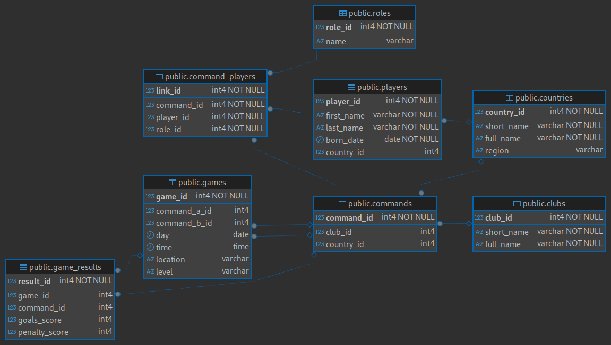
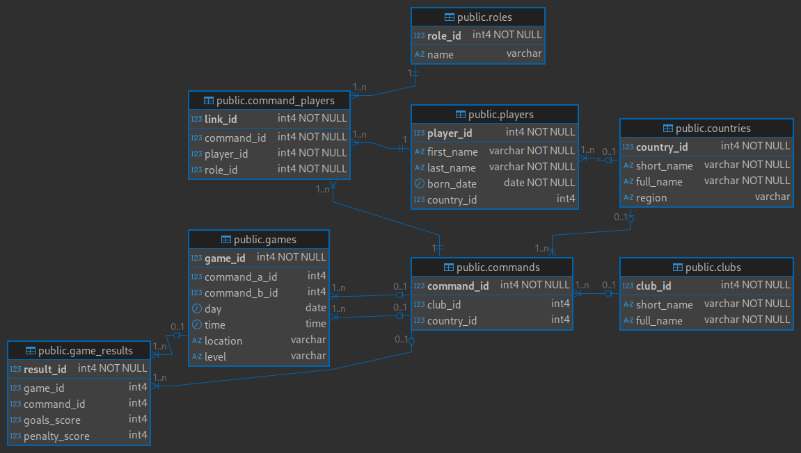

# Вариант 26

## Описание предметной области
 
описание информационной системы чемпионата по футболу. Включает в себя: игроков, команды, страны или клубы, сетку игр, таблицы результатов. Описание игроков включает: фамилию, имя, дату рождения, страну. Описание команд включает в себя перечень игроков и их номеров и амплуа в команде. Также команда связана со страной или клубом (что-то одно). Страна характеризуется кратким и полным названием и регионом (Азия, Европа, Африка, Австралия и Океания, Северная Америка, Южная и Латинская Америка). Клуб характеризуется кратким и полным названиями. Сетка игр включает: две команды, участвующие во встрече, день, время и место проведения встречи, уровень игры с указанием названия подгруппы для группового раунда (групповой раунд, 1/8 финала, ¼ финала, полуфинал, финал, игра за 3-е место). Таблица результатов команд включает для каждого элемента сетки игр: счет (включая возможные послематчевые пенальти) и кол-во очков для группового этапа. Таблица результатов голов включает: кто и из какой команды, в каком матче (элемент сетки), на какой минуте забил гол. Таблица результатов нарушений включает, кто и из какой команды, в каком матче, какую карточку получил и в какое время. Игроки могут менять команды.

## IDEF1X нотация

## Нотация Мартина

